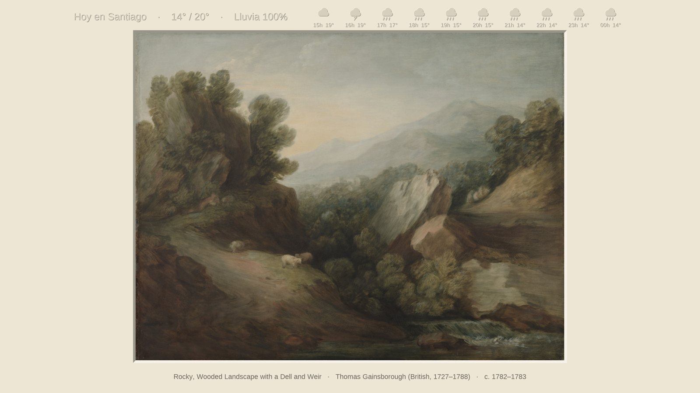
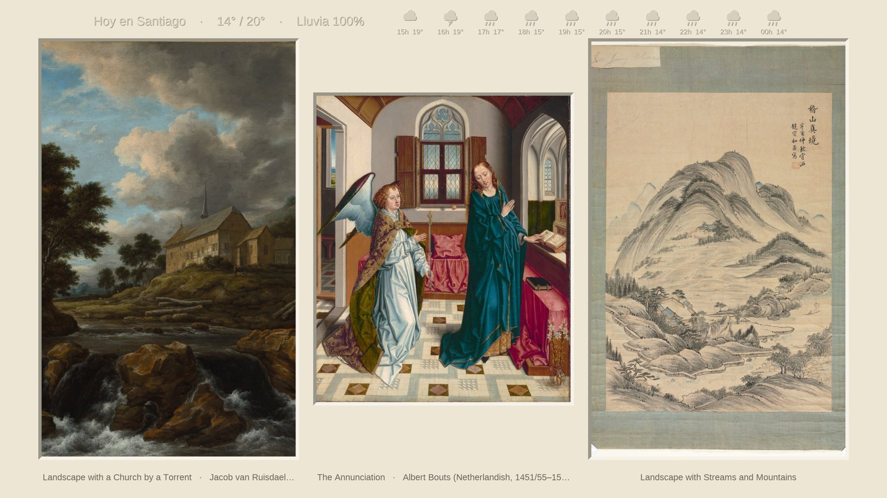

# Frame Art

Rota obras en el modo Arte de una **Samsung Frame**, con paspartú, pronóstico del día y una ficha de la obra
(título, autor, año, descripción), todo desde una interfaz web. Corre en un solo contenedor.

Todo lo que cambia según el gusto de cada quien es un **plugin**: de dónde salen las imágenes, qué se dibuja sobre el
paspartú y cómo se traducen las fichas. Se añaden dejando un archivo en una carpeta, sin tocar el código
ni levantar contenedores extra ([guía de plugins](docs/PLUGINS.md)).



Las fotos verticales se muestran de a tres, cada una con su ficha:



<sub>Obras de dominio público (CC0) del [Cleveland Museum of Art](https://www.clevelandart.org/open-access), con datos de ejemplo para Santiago de Chile.</sub>

## Requisitos

- Samsung Frame (2021 o posterior) en la misma red que el servidor. La primera vez la TV pide aceptar la conexión de «FrameArt».
- Docker con Compose. Basta la red normal de Docker: la app solo abre conexiones salientes hacia la TV (si un firewall se lo impide, ver «Red y firewall»).

## Uso

```sh
git clone https://github.com/ignaciovillela/frame-art && cd frame-art
TV_HOST=192.168.1.50 docker compose up -d     # IP de tu TV
```

Interfaz en `http://<servidor>:8099`. Ahí eliges fuentes, paspartú, franjas, idioma y cada cuánto cambia la obra.

| Variable | Por defecto | Qué hace |
|---|---|---|
| `TV_HOST` | — (obligatoria) | IP de la TV |
| `INTERVAL_HOURS` | 6 | cambio de obra inicial (luego se ajusta en la web) |
| `WEB_PORT` | 8099 | puerto de la interfaz |
| `CACHE_MB` | 500 | tope de la caché en disco de las imágenes originales |
| `PLUGINS_DIR` | /plugins | carpeta de plugins del usuario |
| `EXTRA_PIP` | — | paquetes pip con plugins, p. ej. `mi-plugin==1.0` |
| `FRAMEART_USER_AGENT` | `frame-art/1.0 (+…; uso personal)` | cómo se identifica la app ante los sitios |

## Red y firewall

Normalmente no hay que hacer nada. Si la app dice «TV no disponible» aunque la TV esté encendida, puede que un firewall del servidor
impida a los contenedores llegar a tu red local. Dos salidas:

**1. Excepción en el firewall (recomendada).** Dale a la app una IP fija y permítele hablar solo con la TV:

```sh
# .env
FRAME_ART_SUBNET=10.200.100.0/24      # un rango que no use nada más
FRAME_ART_IP=10.200.100.2
COMPOSE_FILE=docker-compose.yml:docker-compose.fixed-ip.yml

# en el servidor, antes de la regla que bloquea tu LAN en la cadena DOCKER-USER (cámbiala por la IP de tu TV):
iptables -I DOCKER-USER -s 10.200.100.2 -d 192.168.1.50 -j ACCEPT
```

No limites los puertos: la TV pide subir las imágenes por un puerto que elige ella. Para que la regla sobreviva a un reinicio,
guárdala con tu mecanismo habitual (`netfilter-persistent save` en Debian/Ubuntu con `iptables-persistent`).

**2. `docker-compose.host.yml`.** Usa la red del servidor (`COMPOSE_FILE=docker-compose.yml:docker-compose.host.yml`). Es lo más simple,
pero no aísla el contenedor, deja la web en todas las interfaces y no funciona en Docker Desktop.

## Plugins

Todo lo que no es el motor es un plugin, y **no todos se cargan**: el repo trae un catálogo (`app/official/`) y cada quien instala
solo lo que usa desde la web («Catálogo de plugins»). Una instalación nueva trae lo esencial; el resto es opcional.

| Tipo | Plugin | Instalado por defecto | Qué hace |
|---|---|---|---|
| Fuente | **reframed.gallery** | sí | pinturas clásicas en 4K (ver «Uso responsable») |
| Fuente | **Immich** | no | tus propias fotos, todas o de un álbum |
| Fuente | **Cleveland Museum of Art** | no | pinturas CC0 (fuente declarativa, sin código) |
| Franja | **Pronóstico** | sí | temperatura, lluvia y próximas horas ([Open-Meteo](https://open-meteo.com), sin clave) |
| Franja | **Ficha de la obra** | sí | título · autor · año — descripción, en una línea |
| Traductor | **Google Translate (no oficial)** | sí | traduce las descripciones al idioma elegido |

¿Quieres uno que no está? Hay tres caminos: un archivo en `./plugins/` (solo para ti), un paquete pip, o un PR al catálogo
([CONTRIBUTING.md](CONTRIBUTING.md)). Cómo escribirlos: [docs/PLUGINS.md](docs/PLUGINS.md). En `examples/` hay una fuente mínima en Python.

## Uso responsable

- **reframed.gallery** es la colección gratuita de una sola persona. Según [su FAQ](https://www.reframed.gallery/faq) las obras son
  **solo para uso personal, nunca comercial**, sin límite de descargas; su `robots.txt` permite leer el sitio y el
  sitemap. Esta app **no incluye ninguna obra** en el repositorio y las descarga una sola vez (caché en disco, miniatura para comprobar la
  orientación) para no inflar sus contadores ni su tráfico. Si lo usas, considera [dejarle una propina](https://www.reframed.gallery/faq).
  No lo uses con fines comerciales ni para redistribuir el catálogo.
- La app se identifica con un User-Agent propio y **no se hace pasar por un navegador** para saltarse protecciones de ningún sitio.
  Si una fuente bloquea clientes automatizados, elige otra.
- **Google Translate** se usa a través de un endpoint público no oficial: puede cambiar o limitarse sin aviso. Se puede
  desactivar o sustituir por otro traductor plugin; sin traductor las fichas se muestran en su idioma original.
- Cada fuente tiene sus propias condiciones; revísalas antes de añadir plugins.

## Datos y privacidad

Todo queda en `./data` (ajustes, claves, caché, token de la TV). No se envía nada a terceros salvo las consultas a las fuentes,
a Open-Meteo y, si está activo, al traductor. Esa carpeta está en `.gitignore`.

## Licencia

MIT. La fuente Liberation Sans (`app/fonts/`) va con su propia licencia (SIL OFL).
